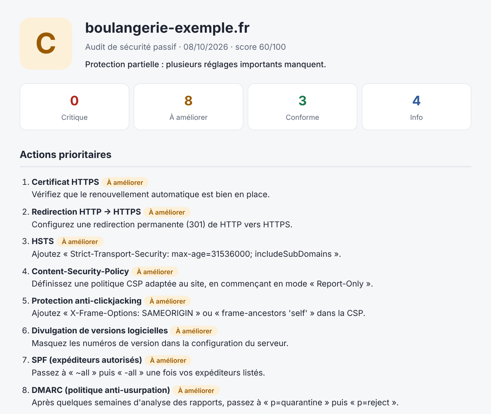

# audit-domaine

**Audit de sécurité passif d'un nom de domaine, avec un rapport clair pour un non-spécialiste.**

En une commande, l'outil vérifie ce que tout le monde peut voir depuis Internet sur un domaine : le site est-il bien protégé en HTTPS, le serveur envoie-t-il les bons en-têtes de sécurité, et surtout, **quelqu'un peut-il envoyer des emails en se faisant passer pour l'entreprise ?** Il produit un rapport HTML noté de A à F, avec des actions concrètes à mener.



## Ce qui est vérifié

| Domaine | Contrôles |
|---|---|
| **Site web** | Certificat valide et date d'expiration, version TLS, redirection HTTP → HTTPS |
| **En-têtes de sécurité** | HSTS, Content-Security-Policy, protection anti-clickjacking, X-Content-Type-Options, Referrer-Policy, Permissions-Policy, divulgation de versions logicielles |
| **Emails** | Serveurs MX, SPF (présence, règle `all`, limite des 10 requêtes DNS), DMARC (politique, couverture, rapports), DKIM (sélecteurs courants) |

Chaque point est classé **Critique**, **À améliorer**, **Conforme** ou **Info**, avec une recommandation en langage simple.

## Un audit strictement passif

L'outil ne fait que ce que fait n'importe quel visiteur ou serveur de messagerie : des lectures DNS publiques, une connexion HTTPS et une requête sur la page d'accueil. **Aucun scan de ports, aucun test d'intrusion.**

Même passif, un audit doit se faire **sur vos propres domaines ou avec l'accord du propriétaire**.

## Installation

```bash
git clone https://github.com/Ryarkhewas/audit-domaine.git
cd audit-domaine
python -m venv .venv
source .venv/bin/activate      # Windows : .venv\Scripts\activate
pip install -r requirements.txt
```

## Utilisation

```bash
# Auditer un domaine (rapport dans rapports/<domaine>.html)
python audit.py mon-domaine.fr

# Choisir le fichier et signer le rapport
python audit.py mon-domaine.fr -o rapports/client.html --auteur "Votre Nom"

# Sortie JSON (pour l'intégrer à un autre outil)
python audit.py mon-domaine.fr --json

# Démonstration sur un domaine fictif, sans réseau
python audit.py --demo
```

L'URL complète est acceptée (`https://www.mon-domaine.fr/contact`) : l'outil en extrait le domaine. Les contrôles email se font sur le domaine principal, même si vous saisissez `www.`.

## Fiabilité du diagnostic

Si une requête DNS échoue (coupure réseau, délai dépassé), l'audit **s'arrête sans produire de rapport** plutôt que de conclure à tort « pas de SPF » ou « pas de DMARC ». Un enregistrement absent et une vérification impossible sont deux choses différentes.

Pour DKIM, il est impossible de lister toutes les clés d'un domaine : l'outil teste les sélecteurs les plus courants. Ne rien trouver est signalé comme une information, pas comme un défaut.

## Notation

Le score part de 100 : −20 par point critique, −5 par point à améliorer.

| Note | Score | Lecture |
|---|---|---|
| A | 90–100 | Très bonne configuration |
| B | 75–89 | Bonne base, quelques points à renforcer |
| C | 60–74 | Protection partielle |
| D | 40–59 | Exposition notable |
| F | 0–39 | Exposition élevée |

## Architecture

```
audit.py                    Ligne de commande
auditdomaine/
  collecte.py               Accès réseau (DNS, TLS, HTTP) — rien d'autre
  email_checks.py           Analyse MX / SPF / DMARC / DKIM
  web_checks.py             Analyse certificat / redirection / en-têtes
  audit.py                  Orchestration et notation
  rapport.py                Rapport HTML, résumé console, JSON
  demo.py                   Données fictives pour la démonstration
tests/                      63 tests, sans accès réseau
```

La collecte est séparée de l'analyse : toutes les règles se testent sur des données fixes, sans dépendre d'Internet.

## Tests

```bash
python -m pytest -q
```

## Limites

L'audit ne couvre ni les applications du site (formulaires, CMS, extensions), ni les postes de travail, ni les comptes utilisateurs. Il donne un état des lieux de l'exposition visible depuis Internet à une date donnée, pas une garantie de sécurité.

## Licence

MIT
