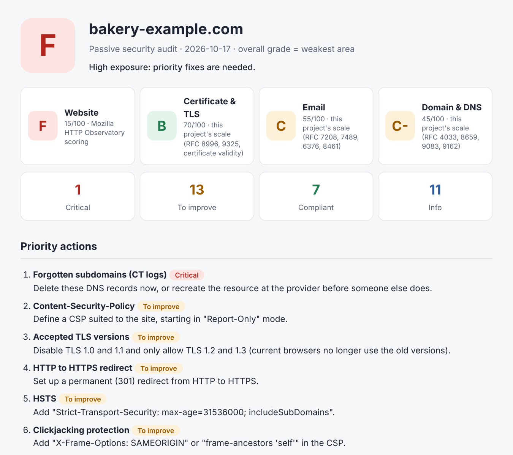

# domain-security-check

[](https://github.com/Ryarkhewas/domain-security-check/actions/workflows/tests.yml) [](https://github.com/Ryarkhewas/domain-security-check/actions/workflows/live-check.yml)

**Passive security audit of a domain name, with a clear report for non-specialists.**

In a single command, the tool checks what anyone can see from the Internet about a domain: is the website properly protected with HTTPS, does the server send the right security headers, and above all, **can someone send emails pretending to be the company?** It produces an HTML report (and, if you want, a PDF) with a grade per area (website, certificate, email, DNS), the points behind each grade, the standard each check relies on, and concrete actions to take. Several domains can be audited at once, with a summary page. Reports exist in English and French, and each new audit of a domain shows what changed since the previous one.



Example reports: [HTML](examples/demo_report.html) and [PDF](examples/demo_report.pdf), and the same in French: [PDF](examples/demo_report_fr.pdf).

## What is checked

| Area | Checks |
|---|---|
| **Website** | HTTP to HTTPS redirect, HSTS (including the browsers' preload list), Content-Security-Policy, cookies (Secure, HttpOnly, SameSite), Subresource Integrity of external scripts, clickjacking protection, X-Content-Type-Options, Referrer-Policy, Cross-Origin-Resource/Opener/Embedder-Policy; not scored: Permissions-Policy, software version disclosure |
| **Certificate & TLS** | Valid certificate, expiry date, TLS version |
| **Email** | MX servers, SPF (presence, `all` rule, 10 DNS lookup limit), DMARC (policy, coverage, reports, inheritance from the parent domain for subdomains), DKIM (common selectors), MTA-STS (record, policy file, mode, coverage of the mail servers); not scored: TLS reporting (TLS-RPT) |
| **Domain & DNS** | DNSSEC (enabled, and consistent between the parent zone and the domain's keys), CAA (which certificate authorities may issue certificates) |

Each item is rated **Critical**, **To improve**, **Compliant** or **Info**, shows the points it weighs in the grade, cites the standard it is based on, and comes with a plain-language recommendation.

## A strictly passive audit

The tool only does what any visitor or mail server does: public DNS lookups, an HTTPS connection, and requests to the home page (over HTTPS and HTTP) and to `robots.txt`, like Mozilla HTTP Observatory. **No port scanning, no intrusion testing.** For email, it reads the domain's MTA-STS policy file when the domain announces one, as any sending mail server does. The only other download is the public [HSTS preload list](https://hstspreload.org/), cached for a week. If the local DNS resolver refuses DNSSEC queries (some routers and Linux setups do), those queries are retried through public resolvers (Cloudflare, Quad9, Google).

Requests identify themselves as a current desktop browser, with `domain-security-check` appended to the User-Agent. Some sites answer differently to bots (no HTTPS redirect, missing headers): this way the report shows what real visitors get, while the tool stays identifiable in server logs.

Even passive, an audit should only be run **on your own domains or with the owner's permission**.

## Installation

Requires Python 3.10 or later.

```bash
# Latest release, straight from GitHub
pip install "git+https://github.com/Ryarkhewas/domain-security-check@v1.2.0"

# With PDF output
pip install "domain-security-check[pdf] @ git+https://github.com/Ryarkhewas/domain-security-check@v1.2.0"

# Or from a clone, to work on the code
git clone https://github.com/Ryarkhewas/domain-security-check.git
cd domain-security-check
python -m venv .venv
source .venv/bin/activate      # Windows: .venv\Scripts\activate
pip install -e ".[dev]"
```

The wheel and source archive of each version are also attached to the [GitHub releases](https://github.com/Ryarkhewas/domain-security-check/releases).

## Usage

```bash
# Audit a domain (report in reports/<domain>.html)
domain-security-check my-domain.com

# Choose the output file and sign the report
domain-security-check my-domain.com -o reports/client.html --author "Your Name"

# Also produce a PDF (install the extra first: pip install "domain-security-check[pdf]")
domain-security-check my-domain.com --pdf

# Report in French
domain-security-check my-domain.com --lang fr

# Several domains: one report each, plus reports/index.html to compare them
domain-security-check client-a.com client-b.fr client-c.org
domain-security-check --file domains.txt --output-dir reports/clients

# JSON output (to feed another tool)
domain-security-check my-domain.com --json

# Demo on a fictitious domain, without network access
domain-security-check --demo
```

A domain file has one domain per line; blank lines and `#` comments are ignored. Several domains are audited at the same time (6 by default, `--workers` to change it). With several domains, a domain that cannot be audited (DNS failure, invalid name) is listed on the summary page with the reason, the others are still audited, and the command ends with exit code 3.

`python -m domaincheck` works the same way, and so does `python domain_check.py` from a clone, without installing.

A full URL is accepted (`https://www.my-domain.com/contact`): the tool extracts the domain. Email checks run on the main domain, even if you enter `www.`.

## Changes since the previous audit

Each report is saved with its result in JSON (`<domain>.json`, next to the HTML report). When the same domain is audited again into the same folder, the new report starts with what changed since then: grades that went up or down, problems fixed, new problems, and problems that got worse or better. The summary page of several domains shows it in one column. This is meant for a regular follow-up, for instance a weekly audit of a client's domains.

`--previous FILE` compares a single domain with any earlier JSON result.

## Languages

`--lang fr` produces the HTML report, the PDF, the summary page and the console summary in French. All texts come from one catalog (`domaincheck/locales/fr.py`), and a test checks that every text of the code has its translation. The JSON output always stays in English, as it is meant for other programs.

## Reliable diagnosis

If a DNS query fails (network outage, timeout), the audit **stops without producing a report** rather than wrongly concluding "no SPF" or "no DMARC". A missing record and a check that could not be performed are two different things.

For DKIM, there is no way to list all of a domain's keys: the tool tests the most common selectors. Finding nothing is reported as information, not as a flaw.

## Grades

The report gives **four grades**, one per area, and an **overall grade equal to the weakest of the four**: a site is only as safe as its weakest point.

| Area | How it is graded |
|---|---|
| **Website** | The [Mozilla HTTP Observatory](https://developer.mozilla.org/en-US/observatory/docs/tests_and_scoring) algorithm, with its official score modifiers: start at 100, apply the penalties, and add bonuses only if the score is still 90 or more. |
| **Certificate & TLS** | This project's scale: −100 for a missing, invalid or expired certificate, −30 for TLS 1.0/1.1 or a certificate expiring within 15 days, −10 within 30 days. |
| **Email** | This project's scale, based on what the standards define as valid: e.g. no DMARC −40, no SPF −30 (−10 if a strict DMARC policy already stops spoofing), `p=none` −20, `?all` −20, no MTA-STS −5, MTA-STS in enforce mode that leaves out a mail server −30. |
| **Domain & DNS** | This project's scale, kept moderate since many large sites still do without these: DNSSEC not enabled −15, broken DNSSEC −50 (resolvers may refuse the domain), no CAA record −5. |

All four use the Observatory grade chart (A+ … F, by steps of 5 points); A+ only exists for the website grade, the only one with bonuses.

Each item of the report shows the points it adds or removes, so every grade can be recomputed by hand.

**Broken HTTPS caps the website grade at F.** If the certificate is invalid or expired, or if the site answers over HTTP but not over HTTPS, visitors are not protected whatever the other settings, and the security headers cannot even be checked. A domain with no website at all (mail only) gets "N/A" for the website and TLS grades, and is graded on email and DNS only.

## Methodology

Every check is based on a published standard or guide, cited under each item of the report.

| Check | Reference |
|---|---|
| Content-Security-Policy | [W3C CSP Level 3](https://www.w3.org/TR/CSP3/) |
| HSTS | [RFC 6797](https://www.rfc-editor.org/rfc/rfc6797), [HSTS preload list](https://hstspreload.org/) (Chromium's list, used by all major browsers) |
| Subresource Integrity | [W3C SRI](https://www.w3.org/TR/SRI/) |
| Clickjacking (X-Frame-Options, frame-ancestors) | [RFC 7034](https://www.rfc-editor.org/rfc/rfc7034) |
| X-Content-Type-Options | [WHATWG Fetch](https://fetch.spec.whatwg.org/#x-content-type-options-header) |
| Referrer-Policy | [W3C Referrer Policy](https://www.w3.org/TR/referrer-policy/) |
| Cookies | [RFC 6265](https://www.rfc-editor.org/rfc/rfc6265), [MDN cookie guide](https://developer.mozilla.org/en-US/docs/Web/Security/Practical_implementation_guides/Cookies) |
| HTTP to HTTPS redirect | [MDN TLS guide](https://developer.mozilla.org/en-US/docs/Web/Security/Practical_implementation_guides/TLS#http_redirection) |
| Cross-Origin-Resource / Opener / Embedder-Policy | MDN reference pages |
| Permissions-Policy, version disclosure (not scored) | [W3C Permissions Policy](https://www.w3.org/TR/permissions-policy/), [OWASP Secure Headers Project](https://owasp.org/www-project-secure-headers/) |
| TLS protocol version | [RFC 8996](https://www.rfc-editor.org/rfc/rfc8996) (TLS 1.0 and 1.1 deprecated) |
| SPF | [RFC 7208](https://www.rfc-editor.org/rfc/rfc7208) |
| DMARC, including subdomain inheritance | [RFC 7489](https://www.rfc-editor.org/rfc/rfc7489) |
| DKIM | [RFC 6376](https://www.rfc-editor.org/rfc/rfc6376) |
| Domains that receive no email | [RFC 7505](https://www.rfc-editor.org/rfc/rfc7505) (null MX) |
| MTA-STS, TLS reporting | [RFC 8461](https://www.rfc-editor.org/rfc/rfc8461), [RFC 8460](https://www.rfc-editor.org/rfc/rfc8460) |
| DNSSEC | [RFC 4033](https://www.rfc-editor.org/rfc/rfc4033) to 4035 |
| CAA | [RFC 8659](https://www.rfc-editor.org/rfc/rfc8659) |
| Website scoring | [Mozilla HTTP Observatory](https://github.com/mdn/mdn-http-observatory) (MPL 2.0) |

**Differences with the Observatory.** One Observatory test is not reproduced: CORS, whose only penalty requires sending a forged `Origin` header. A Content-Security-Policy declared in a `<meta http-equiv>` tag is not read (the `<meta name="referrer">` tag is), and only the first CSP policy is analysed when a site sends several. In these rare cases the website grade can differ from the Observatory's.

**Checked against the Observatory every week.** The Live check workflow asks the [Observatory API](https://github.com/mdn/mdn-http-observatory) for its result on the same domains and compares it test by test. Any test where the points differ is listed, and a grade gap raises a warning. This is how the HSTS preload, Subresource Integrity, cookie collection and `<meta name="referrer">` rules were found and fixed; on 14 October 2026, all six domains (github.com, google.com, cloudflare.com, wikipedia.org, docs.github.com, badssl.com) got exactly the same score, with the same points on every test.

## Project structure

```
domain_check.py             Runs the tool from a clone, without installing
pyproject.toml              Package definition, dependencies, tool settings
domaincheck/
  cli.py                    Command line (domain-security-check)
  collector.py              Network access (DNS, TLS, HTTP), nothing else
  email_checks.py           MX / SPF / DMARC / DKIM / MTA-STS analysis
  dns_checks.py             DNSSEC and CAA analysis
  web_checks.py             Website checks (Mozilla HTTP Observatory tests)
  tls_checks.py             Certificate and TLS checks
  scoring.py                Grades: Observatory algorithm, own scales, overall grade
  sources.py                Standards cited for each check
  audit.py                  Orchestration
  report.py                 HTML report, summary page for several domains, console summary, JSON
  pdf_report.py             PDF report (optional: needs ReportLab)
  history.py                Changes since the previous audit of a domain
  i18n.py, locales/fr.py    Report languages and the French translation
  demo.py                   Fictitious data for the demo
  hsts_preload.py           HSTS preload list (download, cache, lookups)
  observatory.py            Test-by-test comparison with the Observatory API
tests/                      616 unit tests + live tests (tests/live)
scripts/live_summary.py     Audits a list of domains for the Live check workflow
scripts/observatory_compare.py  Compares the website grades with the Observatory
```

Collection is kept separate from analysis: every rule can be tested on fixed data, without depending on the Internet.

## Tests

```bash
python -m pytest -q          # 616 unit tests, no network needed
ruff check .                 # lint
mypy                         # type check
python -m pytest -m live -v  # live tests against real domains (Internet required)
```

Three GitHub Actions workflows keep the tool honest:

- **Tests** runs on every push: the unit tests on Python 3.10 to 3.13, the lint and type checks, and a build of the package installed in a clean environment.
- **Release** publishes a GitHub release, with the package attached, when a version tag is pushed.
- **Live check** runs every Monday (and on demand) against real domains:
  - hosts from [badssl.com](https://badssl.com), deliberately misconfigured for testing (expired, self-signed and wrong-host certificates), must be flagged as critical;
  - for github.com, google.com, cloudflare.com and wikipedia.org, the SPF and DMARC records read by the tool must match those returned by an independent resolver (Google DNS-over-HTTPS);
  - a subdomain (docs.github.com) must inherit its parent's DMARC policy;
  - DNSSEC must match an independent resolver, and CAA (google.com) and MTA-STS (gmail.com) must be found where they are published;
  - the website grade of each domain is compared with Mozilla HTTP Observatory, test by test.

  The results table is published in the workflow summary and the HTML reports are kept as artifacts.

## Limits

The audit does not cover the site's applications (forms, CMS, plugins), workstations or user accounts. It gives an overview of the exposure visible from the Internet at a given date, not a security guarantee.

## Changelog

See [CHANGELOG.md](CHANGELOG.md).

## License

MIT
